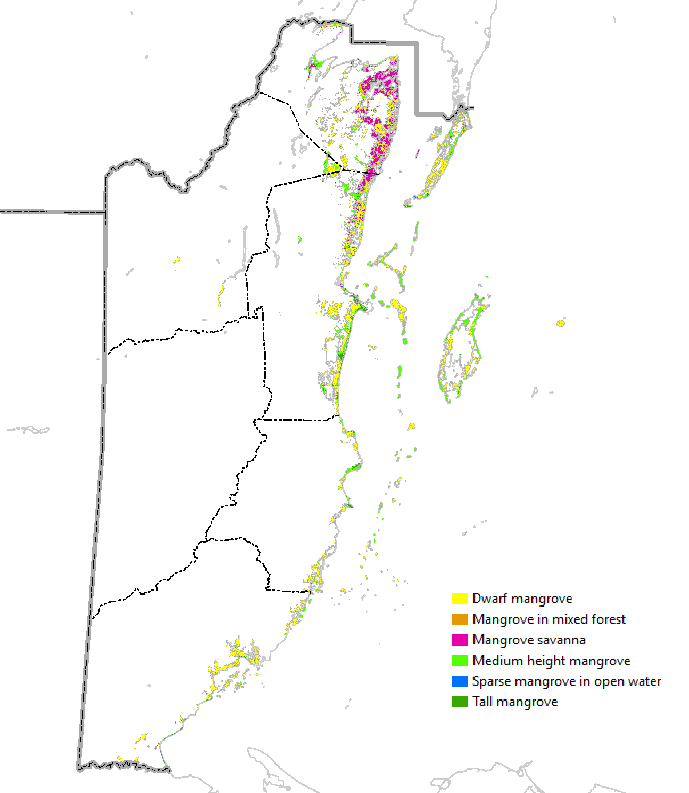
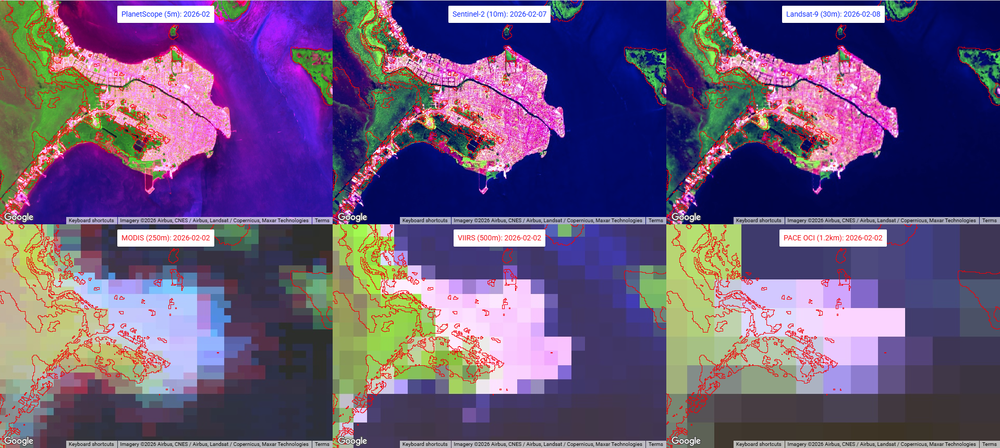
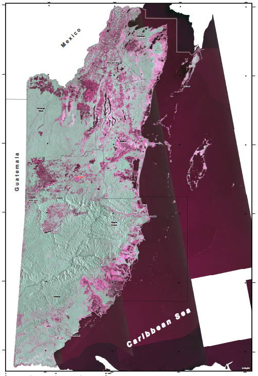
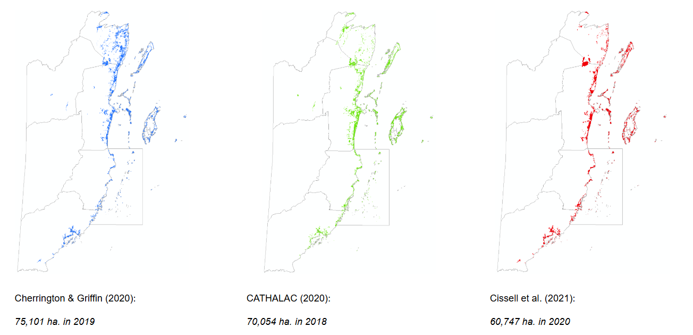
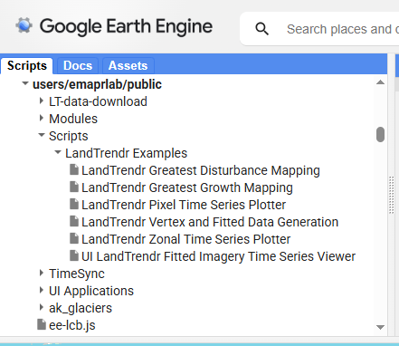
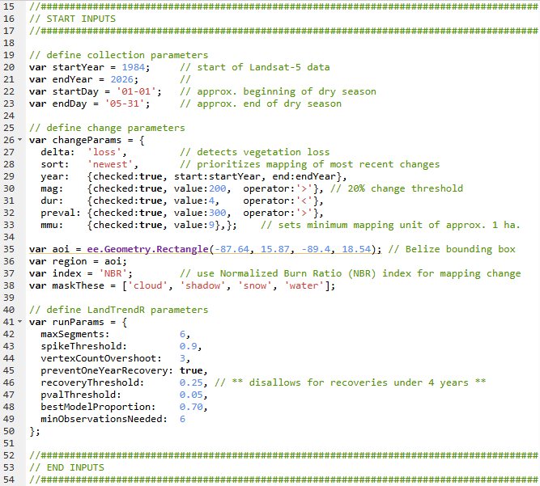
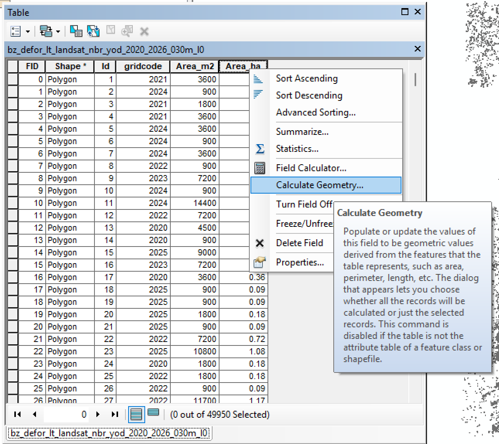

# Monitoring the Mangroves of Belize
*Last updated: November 2026*

## Description
This is a [GitHub](https://github.com) code repository of resources related to mangrove monitoring in Belize, principally using Earth observation data, and satellite data in particular. *This repository will be updated as regularly as is appropriate.*

## Objective
The objective of this repository is to maintain a 'living document' regarding the state of mangrove monitoring in Belize.

***Why care about mangroves?*** Among other things, mangrove ecosystems factor significantly into the various iterations of the Government of Belize's [Nationally Determined Contributions (NDCs)](https://www.unfccc.int/process-and-meetings/the-paris-agreement/nationally-determined-contributions-ndcs) under the Paris Agreement, with both *restoration* and the increased *protection* of mangroves cited in the most recent version of Belize's [NDC submission](https://unfccc.int/sites/default/files/2025-06/BELIZE%20FINAL%20NDC%203.0.pdf), in addition to a proposal for adoption of a [Belize Mangrove Alliance Action Plan](https://wwflac.awsassets.panda.org/downloads/bma_action_plan.pdf) (GOB, 2025; WWF, 2022). Mangroves also feature prominently in Belize's [Forest Reference Level (FRL)](https://redd.unfccc.int/media/belize_forest_reference_level_report_2024_modified_jan_20_2026.pdf) reports, with mangroves being one of the key forest ecosystems assessed and with the utility of remote sensing to monitoring Belize's forests overall being noted (GOB, 2026). Knowing the overall extent of Belize's mangrove ecosystems is also crucial to estimating the country's [blue carbon](https://www.worldbank.org/en/news/feature/2023/11/21/what-you-need-to-know-about-blue-carbon) budget, for instance as presented in [Morrissette et al. (2023)](https://www.unfccc.int/process-and-meetings/the-paris-agreement/nationally-determined-contributions-ndcs). Additionally, it should not be forgotten that the [Laws of Belize](https://www.agm.gov.bz/laws/indices) - specifically the Protection of Mangroves regulations of 1989 in [Chapter 213 of the Laws of Belize](https://forest.gov.bz/wp-content/uploads/2023/09/Forests-Act-cap-213s.pdf) - provide legal protections to Belize's mangrove ecosystems, based on a range of ecosystem services that they provide to the people of Belize.

In terms of general information on Belize's mangroves, there are two [Wikipedia](https://en.wikipedia.org/wiki/Main_Page) articles, one on [coastal mangroves](https://en.wikipedia.org/wiki/Belizean_Coast_mangroves), and another on [reef mangroves](https://en.wikipedia.org/wiki/Belizean_reef_mangroves). In terms of scientific literature, "The Mangroves of Belize: Part 1. Distribution, Composition and Classification" from Murray et al. (2003) provides a comprehensive perspective of Belize's mangroves. 

## Context
To understand the monitoring of mangrove ecosystems in Belize, and particularly the limitations related to such monitoring, it is useful to understand which species of mangrove are found in Belize, and to understand the structural communities they form. More specific to the issue of the limitations related to monitoring mangroves, it is useful to understand the various [Earth observation data](https://www.earthdata.nasa.gov/learn/earth-observation-data-basics) resources that are available for such monitoring.

## Species of mangrove
As documented in Murray et al. (2003), there are three species of mangroves in Belize:
* **Black mangrove** (*Avicennia germinans*),
* **Red mangrove** (*Rhizophora mangle*), and
* **White mangrove** (*Laguncularia racemosa*).

In Belize, there is also one noted mangrove associate:
* **Buttonwood** (*Conocarpus erectus*).

These are the same species found in other parts of the wider Caribbean region (Rull, 2023), i.e., there are no mangrove species found in other parts of the Caribbean that cannot be found in Belize.

## Types of mangroves: Structural classification
As described by Zisman (1998) and Murray et al. (2003), in terms of actually mapping mangrove communities - mixes of multiple species - those communities can largely be described regarding structural classes, as follows:

* **Mangrove savanna:** Zisman (1999) defines this as follows: "This community occurs mostly in the northern half of Belize. It consists of salt tolerant herbaceous plants with scattered stunted mangroves and buttonwood, a common mangrove associate."
* **Dwarf mangrove** stands: Zisman (1999) defines this as follows: "This is the most widespread type of mangrove, encompassing scrubs less than 3m-4m. These include communities where mangrove is continuous to where it grows at relatively low density."
* **Medium mangrove** stands: Zisman (1999) defines this as follows: "These consist of mangrove thickets and shorter mangrove forests. Their height range is from 3m-4m to 7m-8m high."
* **Tall mangrove** stands: Zisman (1999) defines this as follows: "These areas form mangrove forests and are over 7m-8m high."

It should be noted that across various efforts, mangrove formations have either been mapped as a single class (i.e., mangroves), as the classes indicated above (with some additions, e.g., "mangroves in open water" or "mangroves in mixed forest"). To date, no efforts have been published mapping stands of individual mangrove species.

**Figure 1.** Location of mangrove structural types, based on Zisman (1998).

## Timeline
The following is an abridged timeline of efforts to monitor Belize's mangrove resources in the recent past:

* **1990:** Publication of Gray et al. (1990)'s "Mapping of the mangroves of Belize" technical report.
* **1993:** Publication of Zisman's "Mangroves in Belize: Their Characteristics, Use, and Conservation" technical report, funded as a consultancy under the Forest Planning and Management Project (FPMP) with the Forest Department.
*  **1994:** Publication of Fairweather & Gray (1994), a report and accompanying map of Belize's land cover, which included a mangrove class in its legend. The limitations of the data were later explored in the subsequent Zisman (1998) dissertation.
* **1998:** Publication of Simon Zisman's doctoral dissertation on the status of mangrove ecosystems in Belize (Zisman, 1998).
* **1999:** Dr. Simon Zisman gave a public presentation of the findings of his 1998 dissertation at the Radisson Fort George hotel in Belize, where he released technical notes on the associated mangrove spatial data (shapefiles) that he shared. Zisman's work presented mangrove cover to 1992.
* **2003:** Publication of Murray et al.'s "The Mangroves of Belize: Part 1." Notably, a subsequent article was never published by the team.
* **2009:** The [Belize Barrier Reef Reserve System World Heritage Site (BBRRS WHS)](https://whc.unesco.org/en/collections/33/) - the country's only UNESCO World Heritage Site - is placed on the [UNESCO List of World Heritage in Danger](https://whc.unesco.org/en/danger-list/) - where it will remain for almost nine years - because of clearing of mangroves within the protected areas making up the World Heritage Site.
* **2010:** Publication of the Cherrington et al. (2010) report, which updated Zisman (1998)'s work using Landsat data for 1980, 1989, 1994, 2000, 2004, 2010.
* **2011:** Validation of the Cherrington et al. (2010) report, via the Cho-Ricketts & Cherrington (2011) effort, which involved field work conducted by multiple Non-Governmental Organizations (NGOs) across Belize. Gregorio Canto's master's thesis, "A study of mangrove deforestation in Belize from Haulover Bridge to the Sibun River" was also published in 2011.
* **2018:** The Cherrington et al. (2018) technical report is completed and indicates that mangrove clearing within protected areas - including the BBRRS WHS - has slowed to almost nill. The findings are used to demonstrate that the Government of Belize has taken strong actions to cease threats to the BBRRS WHS. At the 42nd session of the World Heritage Committee, the [decision was taken to remove](https://whc.unesco.org/en/news/1838) the BBRRS WHS from the UNESCO List of World Heritage in Danger.
* **2020:** Publication of multiple reports:
  * Cherrington & Griffin (2020) technical report on mangrove change in Belize, funded in the context of Belize's Marine Climate Change Adaptation Project (MCCAP), implemented by the Coastal Zone Management Authority & Institute (CZMAI).
  * Cherrington et al. (2020) paper on mangroves in Belize, a peer-reviewed version of the 2018 technical report, published in the journal [*Remote Sensing of Environment*](https://www.sciencedirect.com/journal/remote-sensing-of-environment).
  * CATHALAC (2020) technical report on land cover in Belize, which includes mangroves as one of the classes mapped using Copernicus Sentinel-2 imagery.
* **2021:** Publication of Cissell et al. (2021), which re-mapped mangrove cover across Belize, using Sentinel-2 imagery.
* **2023:** While not focused exclusively on mangroves, in the context of the [now defunct] NASA / USAID SERVIR program, researchers from the University of Alabama in Huntsville (UAH) - namely Emil Cherrington, Betzy Hernandez, Christine Evans and Lauren Carey - delivered a five-day training workshop in Oct. 2023 on forest monitoring using the [Google Earth Engine (GEE)](https://code.earthengine.google.com) platform. One output of that training was the following GEE code repository, which continues to be updated: https://bit.ly/bz_repo.
* **2024:** In late March 2024, the Belize Forest Department hosted researchers from the University of Alabama in Huntsville (Emil Cherrington and Christine Evans) for a short training on the use of remote sensing for mangrove monitoring and some limited field work.
* **2025:** In September 2025, Emil Cherrington & Rob Griffin of UAH presented their preliminary findings of mangrove change in Belize at the National Forest Monitoring System Symposium in Belize City.
* **2026:** The "Spatial Assessment of Total Mangrove Cover for Belize and Change in Mangrove Cover for Belize (2020-2024)" project is being implemented.

## Earth observation data resources
* **Aerial photography:**
  * **Ortho-photos:** Since colonial times (i.e., circa the mid-20th Century), the United Kingdom's Royal Air Force and the Ordnance Survey imaged Belize's territory multiple times, at a high level of spatial detail. The aquisition of [presumably] the first set of aerial photographs led to the "Land in British Honduras" report (White et al., 1959) which documented the territory's natural resources and produced a 1:250,000 scale map. Repeat acquisitions of aerial photography also formed the basis of the development of at least six series of 1:50,000 scale topographic maps of Belize's territory (divided into 44 individual sheets). The last known set of E755 topographic sheets of Belize were released in 1995, with the notation of being "produced under the direction of the Director General of the Military Survey, Ministry of Defense, United Kingdom." The maps' legend also indicates that, although published in 1995, the source aerial photography was from 1988, with "field completion" in 1990. Since various editions of the maps were available, some of the later editions include a specific mangrove class in terms of the various "vegetation" classes depicted, but Zisman (1998) indicated that such depictions were not comprehensive. In terms of the acquisition of aerial photography as a monitoring option, the cost of acquiring aerial photography of Belize - and processing that imagery to [ortho-photos](https://www.esri.com/about/newsroom/insider/what-is-orthorectified-imagery) - is not known.
  * **UAV (drone) imagery:** The last 10-15 years has also seen a surge in the collection of drone imagery of Belize, although it is doubtful that the drone imagery are processed to orthorectified imagery. Major agencies from the Government of Belize with drone capabilities include (but are not limited to):
    * [Belize Coast Guard](https://bcg.gov.bz/)
    * [Coastal Zone Management Authority & Institute (CZMAI)](https://www.coastalzonebelize.org/), and
    * [Forest Department](https://forest.gov.bz/).
* **Satellite imagery:** Given the relative ease of accessing satellite imagery, the relatively low cost (or no cost), the reality that various satellites can provide complete coverage of Belize's territory, and image archives extending in some cases back to the 1970s, compared to aerial photography, satellite images are a compelling option for monitoring Belize's mangrove ecosystems, providing historical as well as more recent snapshots on the status of mangrove extents.
  * **Multispectral:**
    * **[Landsat](https://science.nasa.gov/mission/landsat/) (1972-present):** Multispectral imagery from the NASA / USGS Landsat program - the longest running civilian Earth observation program in the world - has been regularly collected over Belize since 1972. The first three Landsat satellites (i.e., Landsats 1-3) only possessed four [spectral bands](https://landsat.usgs.gov/what-are-band-designations-landsat-satellites) ranging from green to near-infrared, at a spatial resolution of 60m. The subsequent Landsat satellites (i.e., Landsats 4, 5, 7, 8, 9) possessed six spectral bands ranging from blue to shortwave infrared (with a 30m resolution), in addition to panchromatic and thermal bands, and the most recent two Landsat satellites also possess two additional spectral bands for detecting coastal aerosols and cirrus clouds. The currently operating Landsat-8 and Landsat-9 satellite constellation images Belize's territory every eight days, and the imagery are openly (freely) available. Even prior to the opening of the Landsat archive in early 2008, Landsat imagery factored into multiple efforts related to mapping Belize's mangroves, as well as mapping other vegetation types. Landsat data are also the preferred input for the [LandTrendR](https://emapr.github.io/LT-GEE/landtrendr.html) algorithm and the data off which the algorithm was developed in 2010 (Kennedy et al. 2010). Given that the LandTrendR algorithm is readily available in the GEE platform (Kennedy et al. 2018), LandTrendR has recently been used in multiple studies for mapping mangrove change in Belize (e.g. Cherrington & Griffin 2020, Punalekar et al. 2024, Evans et al. 2025). Given that Landsat data are crucial to mangrove monitoring in Belize, it should be pointed out that Landsat data can be accessed easily for download from the United States Geological Survey (USGS), particularly via the Glovis (https://glovis.usgs.gov/app) or the Earth Explorer (https://earthexplorer.usgs.gov) platforms. Additionally, for processing in the cloud, Landsat data can be accessed and analyzed fairly easily using GEE's Code Editor (https://code.earthengine.google.com).
    * **[Sentinel-2](https://www.esa.int/Applications/Observing_the_Earth/Copernicus/Sentinel-2) (2015-present):** The first of the Sentinel-2 satellites of Europe's [Copernicus Programme](https://www.copernicus.eu/en/homepage) (i.e., Sentinel-2A) was launched in June 2015. While the satellites' Multi Spectral Instrument (MSI) sensors collect data in 13 [spectral bands](https://developers.google.com/earth-engine/datasets/catalog/COPERNICUS_S2_SR_HARMONIZED#bands) ranging from the visible to the shortwave infrared parts of the spectrum, the data are essentially very similar to that from Landsat. (In fact, there is a Harmonized Landsat Sentinel-2, HLS, dataset which combines the six overlapping spectral bands between Landsat and Sentinel-2.) In contrast to Landsat, though, data from the four visible and near-infrared (VNIR) bands are available at a 10m spatial resolution, while a number of other spectral bands are available at 20m resolution, and a few others are available at 60m resolution. Relevant to Belize, it should be noted that CATHALAC used 2018 Sentinel-2 data to map Belize's land cover (including mangroves), while Cissell et al. (2021) used Sentinel-2 to map Belize's mangroves exclusively.
    * **PlanetScope (2015-present):** [Planet Labs PBC](https://www.planet.com/)'s PlanetScope satellites have been imaging Belize's territory on a ~daily basis since 2015, at a resolution of ~3m. From 2020-2025, under a [contract](https://www.bbc.com/news/science-environment-54651453) with Norway's Climate and Forest Initiative (NICFI), Planet Labs made monthly ~5m wall-to-wall mosaics of the tropics - including Belize - available, with the last monthly mosaic covering January 2025. Mosaics were made [available via GEE](https://developers.google.com/earth-engine/datasets/publisher/planet-nicfi), as well as for download. Since the expiration of the [NICFI Satellite Data Program](https://www.ksat.no/earth-observation/-land-monitoring/nicfi-tropical-forest-program/) as it was called, Belize became a beneficiary of a 3-year project under Planet's [Project Centinela](https://www.planet.com/project-centinela/), whereby PlanetScope and other Planet imagery of roughly half of Belize are being made available to a consortium including the Belize Forest Department. It should also be noted that monthly PlanetScope image mosaics continue to be generated by Planet, but outside of the context of the [now expired](https://www.nicfi.no/2025/09/09/norway-cancels-procurement-for-tropical-forest-satellite-data-program/) NICFI Satellite Data Program.
    * **MODIS (2000-present):** Given that mangroves occupy relatively narrow fringes and given that the finest spatial resolution that MODIS data possess are 250m, it is unlikely that those data have the spatial resolution sufficient for monitoring Belize's mangroves.
    * **VIIRS (2012-present):** Given that mangroves occupy relatively narrow fringes and given that the finest spatial resolution that VIIRS data possess are 375m (often resampled to 500m), it is unlikely that VIIRS data have the spatial resolution appropriate for monitoring Belize's mangroves.

**Figure 2.** Comparison of various sources of multispectral imagery over Belize City, with 2019 mangrove polyline boundaries overlaid in red.

  * **Hyperspectral:** Research indicates that compared to multispectal images, hyperspectral images can theoretically be used to differentiate species. That said, hyperspectral imagery of Belize is generally harder to come by. A basic comparison of the main sources of open hyperspectral data can be found at: https://github.com/BzGEO/Hyperspectral_Toolkit/blob/main/README.md#comparison-of-characteristics-of-open-hyperspectral-datasets.
    * **EO-1 Hyperion (2001-2017):** While NASA's EO-1 satellite and its Hyperion hyperspectral sensor was in orbit for over a decade and a half, there aren't many Hyperion images of Belize or Belize's coast. Like Landsat data, Hyperion data are available at a 30m resolution, but Hypersion data have 224 spectral bands, ranging from the visible part of the electromagnetic spectrum to the shortwave infrared part of the spectrum.
    * **EMIT (2022-present):**  NASA's EMIT sensor on the International Space Station (ISS) has imaged Belize's territory - in segments - multiple times over the past almost four years, although many of the hyperspectral images that EMIT has acquired over Belize are cloudy. While there is probably a sufficient number of EMIT images to do some basic hyperspectral characterization of different types of mangrove formations in Belize, one cannot likely count on using EMIT to do regular monitoring of the country's mangrove cover. EMIT's spatial resolution is 60m, and the sensor captures electromagnetic radiation in 285 bands across the visible to shortwave infrared parts of the spectrum.
    * **PACE OCI (2024-present):** Since early March 2024, NASA's PACE satellite has been capturing *daily* hyperspectral imagery of all of Belize's territory via its hyperspectral imager, the Ocean Color Instrument (OCI), which despite its name, also images land as well as ocean. PACE OCI data have a spatial resolution of 1.2 km at nadir, and OCI's [terrestrial-focused] *provisional* surface reflectance product currently (as of version 3.2) has 122 spectral bands, ranging from the visible part of the electromagnetic spectrum to the shortwave infrared part of the spectrum. Since most of Belize's mangrove stands are unlikely to completely cover a 1.2 km x 1.2 km pixel, it is unlikely that PACE OCI data will be very useful for mangrove monitoring.
    * **Planet Tanager (2024-present):** While data from Planet's Tanager constellation are not open, Planet has released an open spatio-temporal asset catalog (STAC), which includes a single image collected on 27 August 2025 over a part of Belize's Corozal District (and including some mangrove areas), although the image is fairly cloudy. See: https://www.planet.com/data/stac/browser/tanager-core-imagery/coastal-water-bodies/20250827_091452_85_4001/20250827_091452_85_4001.json. Tanager data have 30m spatial resolution and 426 spectral bands.
  * **Synthetic aperture radar (SAR):** As documented in Chapter 6 of the [SERVIR SAR Handbook: Comprehensive Methodologies for Forest Monitoring and Biomass Estimation](https://www.earthdata.nasa.gov/learn/earth-observation-data-basics/sar-handbook), SAR data can be useful in mapping and monitoring mangroves, especially since SAR can penetrate cloud cover.
    * **ALOS PALSAR (2007-present):** The initial ALOS PALSAR satellite was launched in early 2006, but publicly available imagery of Belize (accessible via the Alaska Satellite Facility Distributed Active Archive Center) is from 2007. While the L-band PALSAR data provide additional structural discrimination compared to C-band Sentinel-1 data, one challenge is that ALOS PALSAR data are overall difficult to come by, although the Japanese Space Agency (JAXA) has released a number of annual mosaics, some of which are publicly / openly available via Google Earth Engine (see [version 1](https://developers.google.com/earth-engine/datasets/catalog/JAXA_ALOS_PALSAR_YEARLY_SAR) and [version 2.5](https://developers.google.com/earth-engine/datasets/catalog/JAXA_ALOS_PALSAR_YEARLY_SAR_EPOCH) of the mosaic data).
    * **Biomass (2025-present):** While the Biomass mission - launched in April 2025 - represents the first P-band satellite mission (following the collection of the very first spaceborne SAR imagery of the Earth in the late 1970s), the Biomass mission will not image North America, Central America, or the Caribbean, so Biomass imagery of Belize is not anticipated.
    * **NISAR (2025-present):** While the NISAR mission launched in July 2025, as of the writing of this, none of NISAR's L-band imagery over Belize has yet been released publicly. It is anticipated that the data will be released in July 2026, and it is also anticipated that the imagery will appear similar to the [also L-band] ALOS PALSAR data.
    * **Sentinel-1 (2014-present):** The Copernicus programme's C-band Sentinel-1A satellite launched in April 2014, and there is imagery of Belize dating to October 2014. While Sentinel-1 imagery appear to distinguish clear-cutting of forests very well (including clear-cutting of mangroves), mangroves as such do not appear particularly distinct in Sentinel-1 imagery, likely due to the characteristics of C-band SAR data.

**Figure 3.** ALOS PALSAR dual polarization [mosaic](https://github.com/BzGEO/BZ_Mangrove_Monitoring/blob/main/misc/bz_alos_palsar_servir_2010_11x17.pdf) of Belize for 2010, developed by CATHALAC / SERVIR-Mesoamerica in 2011. Although zoomed out, mangrove areas (shown in shades of green) do not appear particularly distinct from other forest types (also shown in shades of green). Download [here](https://github.com/BzGEO/BZ_Mangrove_Monitoring/blob/main/misc/bz_alos_palsar_servir_2010_11x17.pdf).
  
  * **Thermal infrared:** 
    * **Landsat (1984-present):** While Landsat-4 (L4) launched in 1982, there are relatively few available L4 scenes available for Belize (see: https://code.earthengine.google.com/scriptPath=users%2Fservirbz%2Fbz_mrv%3A00_misc%2F_count_images%2F01_count_images_bz_belize_city). However, since then, Landsat-5, -7, -8, and -9 have provided fairly consistent thermal imaging coverage of Belize.
    * **MODIS (2000-present):** Given that mangroves occupy relatively small fringes and given that the spatial resolution of MODIS thermal data are 1km, it is unlikely that those data have the spatial resolution sufficient for monitoring Belize's mangroves.
    * **VIIRS (2012-present):** Given that mangroves occupy relatively small fringes and given that the finest spatial resolution of VIIRS thermal data is 375m, it is unlikely that VIIRS data have the spatial resolution appropriate for monitoring Belize's mangroves.

## Methods: Mapping Changes in Belize's Mangrove Cover
It can be considered that there are two general approaches to looking at mangrove cover and mangrove change in Belize. One approach imvolves choosing an existing baseline and then mapping changes from that baseline. That approach, for instance, has been employed by previous evaluations including the various Cherrington et al. assessments, which treat Zisman's original mangrove data as the baseline from which to map change. The other main approach to mapping mangrove cover specifically is what can be considered one-off approaches which seek to map mangroves from scratch and which essentially ignore earlier efforts as they generally do not incorporate previous knowledge on the state of Belize's mangroves. To that point, an [assessment](https://github.com/BzGEO/BZ_Mangrove_Monitoring/blob/main/misc/bz_mangrove_data_review_2024-03-19.pdf) by Cherrington & Evans in 2024 found that estimates of mangrove cover vary widely between Zisman (1998), CATHALAC (2020), Cissell et al. (2021), and the Global Mangrove Watch, temporal differences notwithstanding (**Table 1**).

**Table 1.** Comparison of area estimates of Belize's mangrove cover.

| Source | Area (ha.) | Approx. data year | Includes inland mangroves? | Includes mangrove savanna? | Data source | Notes |
| --- | --- | --- | --- | --- | --- | --- |
| CATHALAC (2020) | 70,054 | 2018 | Yes | No | Sentinel-2 | part of a national land cover mapping effort |
| Cherrington & Griffin (2020) | 75,101 | 2019 | Yes | Yes | Landsat | based on Zisman (1998) |
| Cissell et al. (2021) | 60,747 | 2020 | No | No | Sentinel-2 | |
| Global Mangrove Watch | 52,189 | 2018 | No | No | ALOS PALSAR, Landsat | part of a global mangrove mapping effort |

**Figure 4.** Comparison of mangrove cover maps of Belize, not including the Global Mangrove Watch map. The overlap between the three data sources shown is only 29,261 hectares.

## Workflow: Mapping mangrove change from a baseline
1. Selection of a baseline dataset for mangrove cover (e.g., Zisman, 1998), from which change will be estimated.
2. Selection of a method and platform for evaluating change (e.g., spectral mixture analysis-based change using [*CLASlite*](https://www.globalgreenmonitoring.org/claslite-software), or changes in normalized burn ratio estimated using the [*LandTrendR*](https://emapr.github.io/LT-GEE/landtrendr.html) algorithm based in the Google Earth Engine platform).
3. Selection of satellite image data sources, preferably multispectral, that are appropriate for the method and platform (e.g., Landsat or Sentinel-2 imagery). It goes without saying that multispectral images need to be cloud-free to be useful. In general, the most cloud-free images of Belize are acquired in the January to May timeframe annually (corresponding roughly with the dry season).
4. Selection of a time period for the change to be mapped (e.g., 2020-2026).
5. Selection of the geographic domain (e.g., all of Belize's territory, or the area known to have mangroves on the coast and inland).
6. Execution of the change detection.
7. Extraction of the results [in a geographic information systems format], preferably as polygon data.
8. Review of the results to confirm changes in mangrove cover, including removal of spurious results.
9. Incorporation of the change data into the baseline map.

## Example workflow: Mapping mangrove change using Google Earth Engine and desktop GIS

*Perform change detection using GEE*
1. LandTrendR is run in GEE over all of Belize for the period 1984-2026, using the repository linked [here](https://code.earthengine.google.com/?accept_repo=users/emaprlab/public). A recurring annual period of 1 January to 31 May is specified to both capture images from the dry season and also to limit the analysis required to compositing 5 months of data rather than 12 months of data. LandTrendR is run using the [Normalized Burn Ratio (NBR)](https://www.usgs.gov/landsat-missions/landsat-normalized-burn-ratio) instead of other indices like the [Normalized Difference Vegetation Index (NDVI)](https://www.usgs.gov/landsat-missions/landsat-normalized-difference-vegetation-index), as research indicates that NBR is more sensitive to clear-cutting than NDVI. Standard parameters found in the [LandTrendR repository](https://code.earthengine.google.com/?accept_repo=users/emaprlab/public) are used for magnitude changes (see the *Greatest Disturbance Mapping* script linked [here](https://code.earthengine.google.com/?scriptPath=users%2Femaprlab%2Fpublic%3AScripts%2FLandTrendr%20Examples%2FLandTrendr%20Greatest%20Disturbance%20Mapping).

**Figure 5.** GEE's LandTrendR [repository](https://code.earthengine.google.com/?accept_repo=users/emaprlab/public) and the location of the *Greatest Disturbance Mapping* script.

**Figure 6.** Adjusted LandTrendR parameters used for mangrove loss mapping in Belize (available [here](https://code.earthengine.google.com/a521c73035b9078de1be455fb43f5aae)).

*Export change data for desktop GIS analysis*

2. Following the completion of a LandTrendR run, which might take up to an hour, LandTrendR data are [exported from GEE to Google Drive](https://developers.google.com/earth-engine/apidocs/export-image-todrive) (as [GeoTIFF](https://www.ogc.org/standards/geotiff/)), and subsequently downloaded to a desktop system. Preferably, the data are extracted from GEE specifying the [EPSG](https://spatialreference.org/ref/epsg/):32616, which is the signifier for UTM Zone 16N. If the specific EPSG reference is not speficied, the data will be exported in the WGS 1984 Geographic Coordinate System (i.e., GCS WGS84) and will later have to be projected.
3. From the exported GeoTIFF, the YOD band (representing the Year of Disturbance) is extracted using a standard geographic information systems (GIS) software package like ArcGIS Desktop, [ArcGIS Pro](https://www.esri.com/en-us/arcgis/products/arcgis-pro/overview), or [QGIS](https://qgis.org). In ArcGIS Desktop and ArcGIS Pro, the tool used to select one raster band from a stack of bands is called **Copy Raster**, and the specific band needs to be selected. By default, LandTrendR will export a six-band dataset, including not only YOD (as band 1), but also bands pertaining to the magnitude of change (band 2), duration of change (band 3), the "Pre-change event spectral value" (band 4), the rate of change (band 5), and the "change magnitude standardized by the LandTrendr fit RMSE" or DNSR (band 6). (*A more detailed explanation of LandTrendR's exports can be found in the API: Functions section of the [LT-GEE Guide](https://emapr.github.io/LT-GEE/api.html#getchangemap).*)
4. After extraction, the YOD data are converted from rater to polygon (using the **Raster to Polygon** tool in ArcGIS).

*Extract changes only for known mangrove areas*

5. Following the polygonization of the LandTrendR YOD data, data are clipped to the boundaries of the baseline mangrove shapefile.

*Estimate polygon areas and extract polygons above a certain threshold*

6. Following clipping, a new field, preferably called **Area_ha** is added to the attribute table of the shapefile.
7. Next, the area of each change polygon is estimated using **Calculate Geometry** and selecting hectares as the unit of measurement.

9. The data are then copied, since the change polygons will be modified.
10. Using the copied data, the attribute table is again opened and using the query tool, an SQL query is performed to select polygons which are **below 1 hectare** in size, and those polygons are deleted. This will ensure that only changes at or above the 1 hectare threshold will be evaluated.

*Audit changes*

10. Base imagery for the years of interest (e.g., 2019, 2020, 2021, 2022, 2023, 2024, 2025, 2026) are loaded into ArcGIS. Those base images can be extracted using LandTrendR.
11. Each and every change polygon will be zoomed to, and compared with the base images and the baseline mangrove shapefile to determine whether or not change has occurred. An annotation will be added to a new field that will be created in the shapefile to note whether or not the changes detected by LandTrendR are valid or spurious.

*Adjust baseline mapped data*

12. After verification of the changes, polygons verified to have changed will be incorporated into the baseline shapefile, with changes noted in the corresponding Description field.

*Summarize change data*

13. For statistical purposes, the areas of change will be tabulated, preferably in a Microsoft Excel spreadsheet.
14. Using the years extracted from the YOD data, changes will be summarized for each year.

<!--
# Other
* Interactive [mapping](https://earthengine-ai.projects.earthengine.app/view/satellite-embedding-classifier) of land cover using the AEF data
-->

<!--
* https://code.earthengine.google.com/d11eba4b896b53c848360b35f088c40e
-->

## Acknowledgements

This effort was funded through a 2026 collaboration with the Forest Department of the Government of Belize's Ministry of Sustainable Development and Climate Change, MSDCC (Professional Service Contract no. 114 of 2025/2026). This work also builds off of multiple projects previously funded by (in chronological order):

* 2007-2008: the Smithsonian Institution's Healthy Reefs Initiative (HRI),
* 2010-2011: the World Wildlife Fund's Mesoamerican Reef (MAR) program,
* 2013: the Toledo Institute for Development and the Environmeng (TIDE),
* 2017-2018: the Belize Audubon Society and the United Nations Development Programme (UNDP) / Global Environment Facility-Small Grants Programme (GEF-SGP), and
* 2019-2020: the Coastal Zone Management Authority & Institute (CZMAI) / the Marine Climate Change Adaptation Project (MCCAP).

The following individuals at the Belize Forest Department were instrumental to the recent effort: Florencia Guerra (Sustainable Forest Management Program lead), Edgar Correa (Monitoring, Reporting, and Verification lead and current Ph.D. student at Kyushu University), Minerva Gonzalez (Restoration Program lead), Koren Sanchez, Karlene Williams, Anthony Morgan, Wilber Sabido (former Chief Forest Officer), and John Pinelo (current acting Chief Forest Officer).

## References

* Bunting, P., Rosenqvist, A., Lucas, R.M., Rebelo, L.M., Hilarides, L., Thomas, N., Hardy, A., Itoh, T., Shimada, M., Finlayson, C.M. 2018. The Global Mangrove Watch—A new 2010 global baseline of mangrove extent. Remote Sensing, 10 (10): 1669. https://doi.org/10.3390/rs10101669

* Bunting, P., Rosenqvist, A., Hilarides, L., Lucas, R. M., Thomas, N., Tadono, T., Worthington, T. A., Spalding, M., Murray, N. J., & Rebelo, L.-M. 2022. Global mangrove extent change 1996–2020: Global Mangrove Watch Version 3.0. Remote Sensing, 14(15), 3657. https://doi.org/10.3390/rs14153657

* Centro del Agua del Trópico Húmedo para America Latina y el Caribe (CATHALAC). 2020. The Development of a Land Use Land Cover Map of 2018 Using Sentinel-2 Images under the REDD+ Readiness Project in Belize. Technical report. Forest Department, Ministry of Fisheries, Forestry, the Environment, and Sustainable Development (MAFFESD). Belmopan, Belize. 171 pp.

* Cherrington, E.A., Hernandez, B.E., Trejos, N.A., Smith, O.A., Anderson, E.R., Flores, A.I., and Garcia, B.C. 2010. Identification of Threatened and Resilient Mangroves in the Belize Barrier Reef System. Technical report to the World Wildlife Fund. Water Center for the Humid Tropics of Latin America and the Caribbean / Regional Visualization & Monitoring System (SERVIR). Panama City, Panama. 28 pp. https://www.researchgate.net/publication/257579955_Identification_of_Threatened_and_Resilient_Mangroves_in_the_Belize_Barrier_Reef_System

* Cherrington, E.A. 2013. Baseline assessment of seagrass and mangrove cover and dynamics in the Port Honduras Marine Reserve, Belize. Technical report to the Toledo Institute for Development and the Environment.  Water Center for the Humid Tropics of Latin America and the Caribbean. Panama City, Panama. 13 pp. https://doi.org/10.13140/RG.2.2.10708.91523

* Cherrington, E.A., Griffin, R.E., Anderson, E.R., Hernandez Sandoval, B.E., Flores Cordova, A.I., Muench, R.E., Markert, K.N. 2018. An assessment of changes in mangrove cover across the Belize Barrier Reef Reserve System World Heritage Site: 1996-2017. Technical report. University of Alabama in Huntsville / Belize Audubon Society. Huntsville, Alabama. 24 pp.

* Cherrington, E.A., Griffin, R.E. 2020. Spatial Assessment of Total Mangrove and Littoral Forest Cover for Belize, 2014-2019. Technical report. Coastal Zone Management Authority & Institute (CZMAI) / Marine Conservation & Climate Adaptation Project (MCCAP). Belize City, Belize. 12 pp.

* Cherrington, E.A., Griffin, R.E., Anderson, E.R., Hernandez Sandoval, B.E., Flores Cordova, A.I., Muench, R.E., Markert, K.N., Adams, E.C., Limaye, A.S., Irwin, D.E. 2020. Use of public Earth observation data for tracking progress in sustainable management of coastal forest ecosystems in Belize, Central America. Remote Sensing of Environment, 245: 111798. https://doi.org/10.1016/j.rse.2020.111798

* Cherrington, E.A. 2023. Bibliography - Remote sensing of Forests in Belize. Dataset. http://bit.ly/bz_rs_biblio. Accessed 05/2026.

* Cherrington, E.A., Evans, C.A. 2024. Revision of Belize Mangrove Datasets for 2018-2020. PowerPoint presentation. SERVIR Science Coordination Office. Huntsville, AL. 48 pp. https://bit.ly/bz_mangrove_comparison_2024. Accessed 05/2026.

* Cherrington, E. 2026. Hyperspectral Data Toolkit (Version 1.0.0.6) Computer software. https://doi.org/10.5281/zenodo.18382541

* Cherrington, E. 2026. PACE OCI data Toolkit (Version 1.0.0.6) Computer software. https://doi.org/10.5281/zenodo.18382540

* Cho-Ricketts, L., Cherrington, E.A. 2011. Validation of the 2010 Belize Mangrove Map. Technical report to the World Wildlife Fund. University of Belize, Water Center for the Humid Tropics of Latin America and the Caribbean. Belmopan, Belize. 13 pp. https://www.researchgate.net/publication/283422391_Validation_of_the_2010_Belize_Mangrove_Cover_Map

* Cissell, J.R., Canty, S.W.J., Steinberg, M.K., Simpson, L.T. 2021. Mapping National Mangrove Cover for Belize Using Google Earth Engine and Sentinel-2 Imagery. Applied Sciences, 11 (9), 4258. https://doi.org/10.3390/app11094258

* Derouin, S. 2026. Mangroves may be losing their grip on carbon storage as sea levels rise. Eos, 107, https://doi.org/10.1029/2026EO260144

* Environmental Systems Research Institute (Esri). 2016. What is orthorectified imagery? Web page. https://www.esri.com/about/newsroom/insider/what-is-orthorectified-imagery. Accessed 05/2026.

* Evans, C.E., Carey, L.E., Guerra, F., Cherrington, E.A., Correa, E.S., Quintero, D. 2025. Cloud-Based Solutions for Monitoring Coastal Ecosystems and the Prioritization of Restoration Efforts Across Belize. Remote Sensing, 17(20): 3396. https://doi.org/10.3390/rs17203396

* Flores-Anderson, A. I., Herndon, K., Thapa, R., & Cherrington, E. (Eds.). 2019. SAR Handbook: Comprehensive Methodologies for Forest Monitoring and Biomass Estimation. NASA. 306 pp. DOI:10.25966/nr2c-s697. https://www.earthdata.nasa.gov/learn/earth-observation-data-basics/sar-handbook

* Gorelick, N., Hancher, M., Dixon, M., Ilyushchenko, S., Thau, D., Moore, R. 2017. Google Earth Engine: Planetary-scale geospatial analysis for everyone. Remote Sensing of Environment, 202: 18-27. https://doi.org/10.1016/j.rse.2017.06.031

* Government of Belize (GOB). 2025. Belize's Third Nationally Determined Contribution: NDC 3.0. Ministry of Sustainable Development, Climate Change, and Solid Waste Management. Technical report to the United Nations Framework Convention on Climate Change (UNFCCC). Belmopan, Belize. 128 pp. https://unfccc.int/sites/default/files/2025-06/BELIZE%20FINAL%20NDC%203.0.pdf

* Government of Belize (GOB). 2026. Belize Modified Forest Reference Level (FRL) 2000-2020. Ministry of Sustainable Development, Climate Change, and Solid Waste Management. Technical report to the United Nations Framework Convention on Climate Change (UNFCCC).  Belmopan, Belize. 196 pp. https://redd.unfccc.int/media/belize_forest_reference_level_report_2024_modified_jan_20_2026.pdf

* Iwantoro, A. P., Urrego, D. H., Xie, D., Nicholas, A. P., Hapsari, K. A., Rodríguez-Rodríguez, J. A., et al. 2026. The Importance of scale in the future of mangrove blue carbon under sea-level rise. Earth's Future, 14, e2025EF006984. https://doi.org/10.1029/2025EF006984

* Kennedy, R.E., Yang, Z., Cohen, W.B. 2010. Detecting trends in forest disturbance and recovery using yearly Landsat time series: 1. LandTrendr — Temporal segmentation algorithms. Remote Sensing of Environment 114: 2897-2910. https://doi.org/10.1016/j.rse.2010.07.008

* Kennedy, R.E., Yang, Z., Gorelick, N., Braaten, N., Cavalcante, L., Cohen, W.B., Healey, S. 2018. Implementation of the LandTrendr Algorithm on Google Earth Engine. Remote Sensing 10 (5): 691. https://doi.org/10.1016/j.rse.2010.07.008

* Kjerfve, B., Oxenford, H. A., Collin, R., Pestana, I. A., Samper-Villarreal, J., Medina-Gómez, I., Cortés, J., Smith, S. R., Koltes, K., Feller, I. C., & CARICOMP Network. 2025. Two decades of CARICOMP mangrove monitoring (1992–2013) reveal variability in tree structure and productivity of *Rhizophora mangle* across the wider Caribbean. Environments, 12(12), Article 463. https://doi.org/10.3390/environments12120463

* Morrissette, H.K. et al. 2023. Belize Blue Carbon: Establishing a national carbon stock estimate for mangrove ecosystems. Science of the Total Environment 870: 161829. https://doi.org/10.1016/j.scitotenv.2023.161829

* Murray, M.R., Zisman, S.A., Furley, P.A., Munro, D.M., Gibson, J., Ratter, J., Bridgewater, S., Minty, C.D., Place, C.J. 2003. The Mangroves of Belize: Part 1. Distribution, Composition and Classification. Forest Ecology and Management 174 (1-3): 265-279. https://doi.org/10.1016/S0378-1127(02)00036-1

* Punalekar, S., Canty, S.W.J., Fergus, C., Huang, Q., Songer, M., Nowakowski, A.J., Connette, G.M. 2024. Characterizing the dynamics of mangrove forests in the Mesoamerican reef region using remote sensing methods. AGU Fall Meeting 2024. Poster. Poster No. 158, id. GC51O-0158. https://ui.adsabs.harvard.edu/abs/2024AGUFMGC51O0158P/abstract

* Punalekar, S., Nowakowski, A.J., Canty, S.W.J., Fergus, C., Huang, Q., Songer, M., Connette, G.M. 2025. Characterizing Role of Spatial Features in Improving Mangrove Classification—A Case Study over the Mesoamerican Reef Region. Remote Sensing 17(16): 2837. https://doi.org/10.3390/rs17162837

* Rull, V. 2023. Rise and fall of Caribbean mangroves. Science of the Total Environment 885: 163851. https://doi.org/10.1016/j.scitotenv.2023.163851

* World Wildlife Fund (WWF). 2022. Belize Mangrove Alliance Action Plan: 2022-2027. Belize City, Belize. 38 pp. https://wwflac.awsassets.panda.org/downloads/bma_action_plan.pdf

* Zisman, S.A. 1998. Sustainability or Status Quo: Elite Influence and the Political Ecology of Mangrove Exploitation in Belize. Doctoral dissertation, Department of Geography, University of Edinburgh. Edinburgh, Scotland. 277 pp. https://www.era.lib.ed.ac.uk/bitstream/handle/1842/22768/ZismanS_1998redux.pdf

* Zisman, S.A. 1999. Explanatory Notes for the Zisman Mangrove Map. Notes from a presentation to the Belize Coastal Zone Management Project. Belize City, Belize. 6 pp.

## Contact information

If you have any questions, feel free to contact Emil Cherrington by :envelope_with_arrow: email: **emil.cherrington [at] nd.edu**.

<!--
https://earthengine-ai.projects.earthengine.app/view/satellite-embedding-classifier#model=2025_h1_global_se_v1;state=V3.%7B*layers*~(%7B*color*~*%230064c8*!*locked*~false!*name*~*Water*!*shown*~false%7D!%7B*color*~*%2338814e*!*locked*~false!*name*~*Forest*!*shown*~false%7D!%7B*color*~*%2300cf75*!*locked*~false!*name*~*Mangrove*!*shown*~true%7D!%7B*color*~*%23b50000*!*locked*~false!*name*~*Urban*!*shown*~false%7D!%7B*color*~*%23ffbb22*!*locked*~false!*name*~*Nonxx005Fforestxx005Fveg*!*shown*~false%7D!%7B*color*~*%23c8e6f8*!*locked*~false!*name*~*Wetlands*!*shown*~false%7D!%7B*color*~*%23f096ff*!*locked*~false!*name*~*Savanna*!*shown*~false%7D)!*geoms*~%7B*2024*~((-88.22831!17.24139!-88.15965!17.13644!-88.2393!17.16793!-88.33543!17.35415!-87.55265!17.34891!-87.78886!16.82121!-88.20359!16.82384!-87.29447!17.76004!-88.0262!18.27036!-88.24592!18.44241!-88.03718!17.98323!-87.74604!17.6904)!(-87.87294!18.11993!-87.87947!18.11161!-87.88925!18.11014!-87.87088!18.13168!-87.87363!18.11063!-88.606!17.00389!-88.69252!16.93427!-88.75706!16.89748!-88.83671!16.88303!-88.99464!16.8252!-89.0276!17.04722!-88.83534!17.11548!-88.88203!17.11548!-88.52223!16.86332!-88.46867!16.93821!-88.47829!17.05116!-88.46867!17.13517!-88.49932!17.66802!-88.52095!17.6533!-88.50413!17.67031!-88.51924!17.66769!-88.51992!17.65003!-88.45881!17.67816!-88.92703!15.89781!-88.93775!15.90334!-88.94076!15.90788!-89.00852!17.63458!-89.00753!17.63454!-88.90856!17.64315!-88.90751!17.64505)!(-87.84522!18.1161!-87.83423!18.12091!-87.83732!18.11944!-87.83938!18.11822!-87.92075!18.09497!-87.92109!18.09171!-87.92144!18.09007!-88.89727!17.66285!-88.89057!17.65778!-88.8904!17.65091!-88.89469!17.6586!-88.89916!17.65893!-88.89298!17.65729!-88.8983!17.65664!-88.89589!17.65647!-88.89298!17.65091!-88.90104!17.65778)!(-88.1961!17.50641!-88.20571!17.51067!-88.22562!17.51427!-88.1985!17.50117!-88.20468!17.48218!-88.19369!17.49495!-88.53888!18.00057!-88.53811!18.00057!-88.49099!17.99648!-88.49116!17.99502!-88.49133!17.99934!-88.52438!18.01763!-88.52223!18.01722!-88.5194!18.01665!-88.51768!18.0164!-88.55974!18.03983!-88.55957!18.03468!-88.56678!18.04472!-88.56626!18.00465!-88.60368!18.00481)!(-88.78659!17.43578!-88.77904!17.42972!-88.7617!17.46214!-88.76874!17.45936!-88.84942!17.39925!-88.85508!17.39499!-88.83002!17.39237!-88.75312!17.4325!-88.38353!17.3909!-88.42198!17.26701!-88.76736!17.33847!-88.79826!17.28144!-88.68703!17.31159!-88.96374!17.22439!-88.52978!17.38893)!(-88.88611!17.70145!-88.88182!17.69704!-88.87581!17.70701!-88.88113!17.71094!-88.88113!17.70521!-88.89006!17.68608!-88.88954!17.69344!-88.88456!17.69115!-88.88868!17.68575!-88.88439!17.68624!-88.5407!18.39106!-88.53212!18.39986!-88.54208!18.36891!-88.51461!18.4155!-88.59941!18.29428!-88.56611!18.3562!-88.505!18.43569!-88.35548!17.72213!-88.35428!17.72115!-88.35694!17.72082!-88.39874!17.74319!-88.39647!17.74201!-88.55549!18.02133!-88.55506!18.02335!-88.55534!18.02127!-88.55281!18.02364!-88.55354!18.02351!-88.55625!18.0212)!(-88.63636!16.34769!-88.59791!16.35955!-88.47488!16.49372!-88.48449!16.59113!-88.44741!16.62008!-88.40003!16.62535!-88.41171!16.68258!-88.38767!16.74769!-88.46664!16.47265!-88.5099!16.4733!-88.57169!16.4845!-88.71658!16.51544!-88.7104!16.5003!-88.68156!16.49898!-88.69048!16.44828!-88.64173!16.39757!-88.62525!16.40284!-88.58199!16.4575!-88.56208!16.47396!-88.46664!16.46804!-88.4941!16.54901))%7D%7D;z=8;lat=17.175;lon=-88.458;
-->

<!--
https://code.earthengine.google.com/8701f99f34b91945afe32011efa618c3
-->
